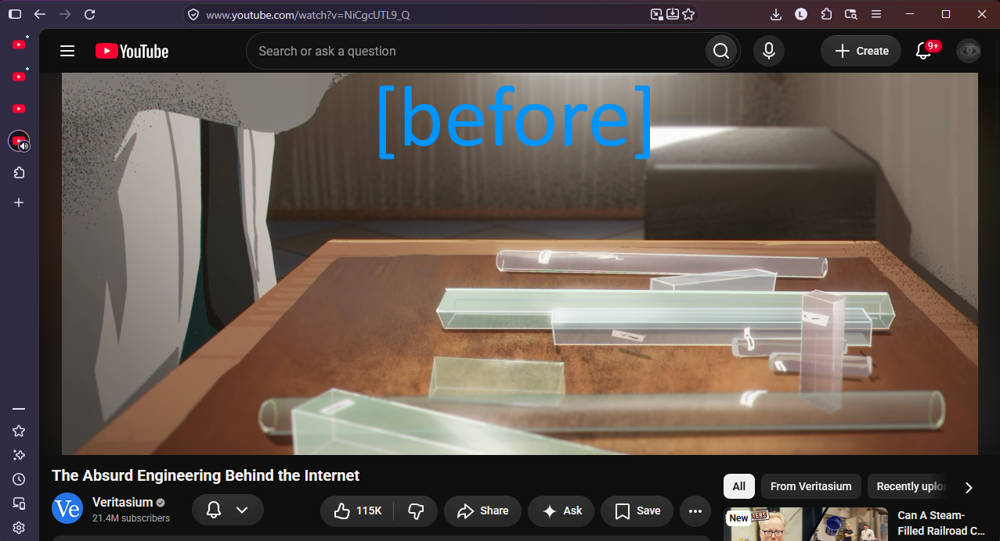
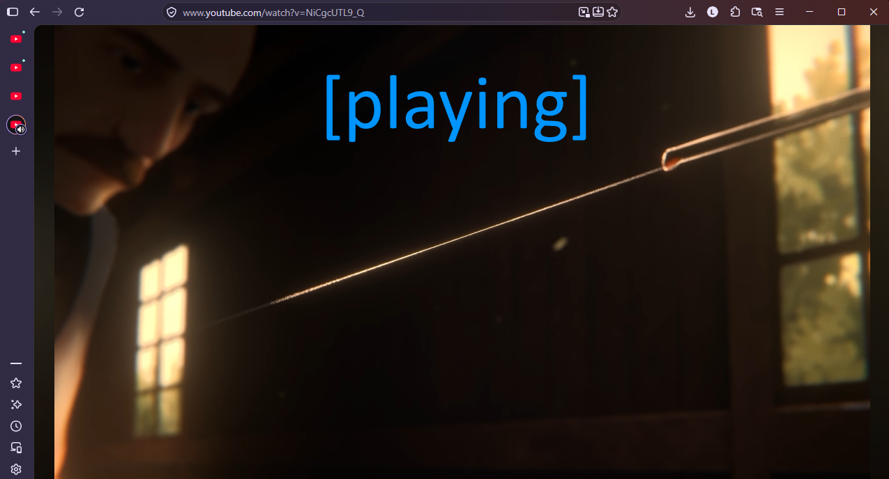
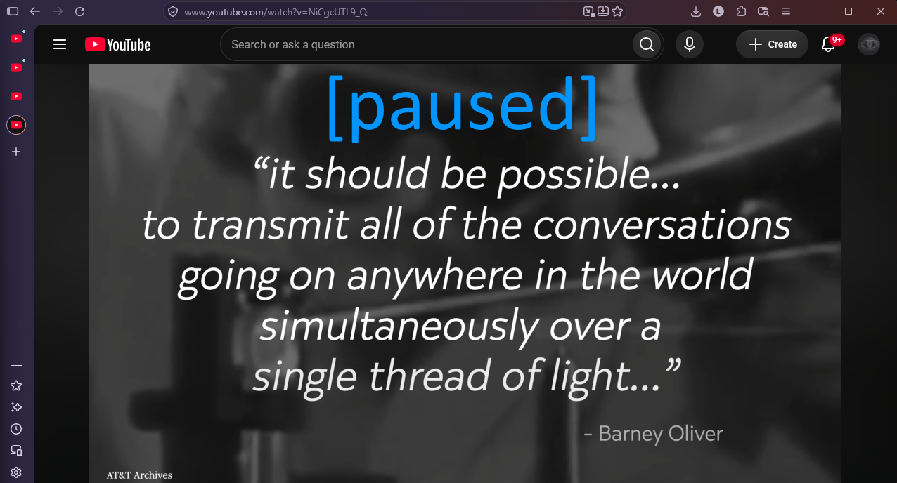

# YouTube Fullscreen Viewport


https://addons.mozilla.org/en-US/firefox/addon/youtube-tile-view/

> Curated slopware

This extension adjusts YouTube so the video player takes up the entire viewport.

---

# Why?

### Does it bother you that the youtube video player only takes up 75% of the screen when the window is tiled?



### After installation



> Masthead is hidden when video is playing.



> Masthead slides back into view when video is paused or completes.

---

## 🌟 Key Features

- **Theater Mode Viewport Expansion**: When in theater mode, expands the video container (`#full-bleed-container`) to occupy the exact remaining screen height on load (`calc(100vh - 56px)`).
- **Auto-Hide Header on Play**: As soon as playback starts (`play` / `playing` events) in theater mode, the top masthead squishes smoothly upwards and fades out, allowing the video player to expand to `100vh`.
- **Smooth Header Easing on Pause**: Pausing or finishing a video (`pause` / `ended` events) brings the top bar smoothly back down into view.
- **Fluid CSS Transitions**: Utilizes `cubic-bezier(0.4, 0, 0.2, 1)` transitions for fluid resizing without sudden jumps or visual glitches.
- **Ambient / Cinematic Mode Compatible**: Carefully layers z-indexes so YouTube's background ambient glow canvas (`#cinematic-container`) remains intact without occluding the video or causing black screens.
- **SPA Navigation Aware**: Integrates with YouTube's internal Single Page App (SPA) navigation lifecycle (`yt-navigate-finish`) and dynamically attaches listeners using `MutationObserver`.

---

## File Details

- **[`manifest.json`](manifest.json)**: Configures the extension for `*://*.youtube.com/*` with `document_idle` execution.
- **[`content.js`](content.js)**: Observes video element creation and theater mode state changes, listens for playback state events (`play`, `playing`, `pause`, `ended`), toggles the `yt-topbar-hidden` class on the root HTML element while in theater mode, and triggers YouTube's internal `resize` dispatch to recalculate video dimensions.
- **[`content.css`](content.css)**: Implements transform scaling (`translateY(-100%) scaleY(0)`), opacity fades, and sizing transitions for `#full-bleed-container` and `#page-manager` scoped to theater mode.

---

## 🚀 Installation & Development

### Firefox (Temporary Add-on)

1. Clone or download this repository to your local machine:
   ```bash
   git clone https://github.com/ramity/youtube-tile-viewer.git
   ```
2. Open Firefox and navigate to:
   ```text
   about:debugging#/runtime/this-firefox
   ```
3. Click **Load Temporary Add-on...**.
4. Browse to the project folder and select [`manifest.json`](manifest.json).
5. Open any YouTube watch page (e.g. `https://www.youtube.com/watch?v=...`) to test.

### Making Changes & Reloading

1. Modify `content.js` or `content.css`.
2. Return to `about:debugging#/runtime/this-firefox`.
3. Locate **YouTube Fullscreen Viewport** and click **Reload**.
4. Refresh your YouTube tab to apply changes.

---

## 🎮 Usage

1. Open any YouTube video and switch to **Theater Mode** (press <kbd>t</kbd>).
2. **Press Play** (or spacebar / <kbd>k</kbd>): The navigation bar smoothly slides and squishes away, expanding the player to full viewport height.
3. **Press Pause**: The navigation bar smoothly slides back into view, restoring access to search, notifications, and profile menus.
